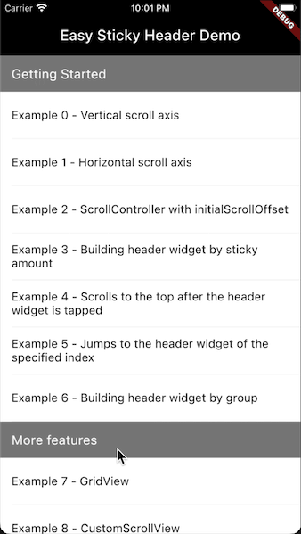
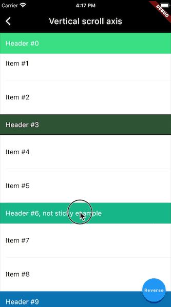
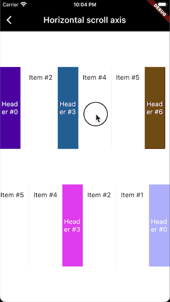
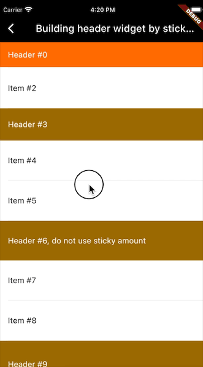
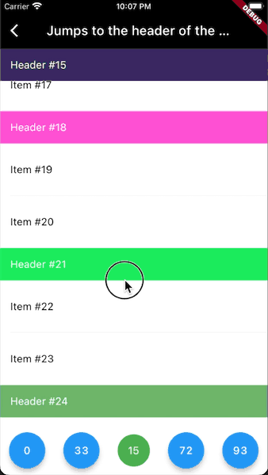
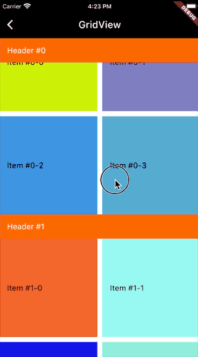
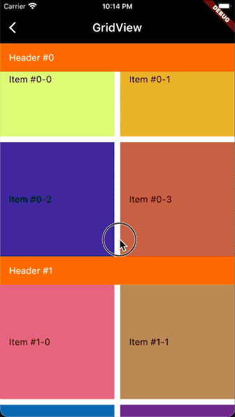
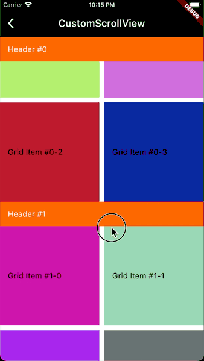
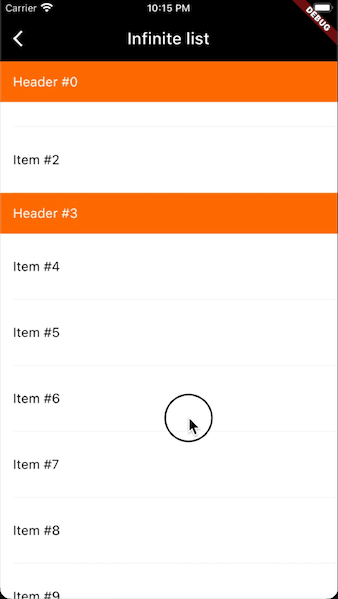

# easy_sticky_header

[](https://flutter.dev)
[](https://pub.dev/packages/easy_sticky_header)
[](https://opensource.org/licenses/MIT)
[](https://github.com/crasowas/easy_sticky_header/issues)
[](https://github.com/crasowas/easy_sticky_header/commits)

## [English](https://github.com/crasowas/easy_sticky_header/blob/main/README.md) | 中文

一个易用且功能强大的粘性头部组件库，适用于任何支持滚动的组件。

## 介绍

* [博客](https://blog.csdn.net/crasowas/article/details/126838153)

## 特性

* 支持水平或垂直方向滚动的组件
* 支持反向滚动的组件
* 允许动态构建头部组件，支持自定义过渡动画
* 头部组件可以动态改变粘性
* 支持跳转到指定索引的头部组件
* 支持头部组件分组
* 支持无限列表

## 用法

添加依赖：

```yaml
dependencies:
  easy_sticky_header: ^1.1.1
```

导入包：

```dart
import 'package:easy_sticky_header/easy_sticky_header.dart';
```

示例：

```dart
class Example extends StatelessWidget {
  @override
  Widget build(BuildContext context) {
    return StickyHeader(
      child: ListView.builder(
        itemCount: 100,
        itemBuilder: (context, index) {
          // Custom header widget.
          if (index % 3 == 0) {
            return StickyContainerWidget(
              index: index,
              child: Container(
                color: Color.fromRGBO(Random().nextInt(256),
                    Random().nextInt(256), Random().nextInt(256), 1),
                padding: const EdgeInsets.only(left: 16.0),
                alignment: Alignment.centerLeft,
                width: double.infinity,
                height: 50,
                child: Text(
                  'Header #$index',
                  style: const TextStyle(
                    color: Colors.white,
                    fontSize: 16,
                  ),
                ),
              ),
            );
          }
          // Custom item widget.
          return Container(
            width: double.infinity,
            height: 80,
            color: Colors.white,
          );
        },
      ),
    );
  }
}
```

想了解更多功能请前往[示例项目](https://github.com/crasowas/easy_sticky_header/blob/main/example)查看详情。

### 刷新 StickyHeaderWidget

在不滚动的情况下，如果头部内容发生了变化，可以手动触发刷新：

```dart
StickyHeader.of(context)?.refresh();
```

## 截图

||||
|:---:|:---:|:---:|
||||
||||

## 贡献

欢迎你来为这里做出贡献 😄！

如果你发现bug或者想要新功能，可以提[issue](https://github.com/crasowas/easy_sticky_header/issues)。

如果你修复了bug或者实现了新功能，可以提PR。

## 许可协议

```
MIT License

Copyright (c) 2022 crasowas

Permission is hereby granted, free of charge, to any person obtaining a copy
of this software and associated documentation files (the "Software"), to deal
in the Software without restriction, including without limitation the rights
to use, copy, modify, merge, publish, distribute, sublicense, and/or sell
copies of the Software, and to permit persons to whom the Software is
furnished to do so, subject to the following conditions:

The above copyright notice and this permission notice shall be included in all
copies or substantial portions of the Software.

THE SOFTWARE IS PROVIDED "AS IS", WITHOUT WARRANTY OF ANY KIND, EXPRESS OR
IMPLIED, INCLUDING BUT NOT LIMITED TO THE WARRANTIES OF MERCHANTABILITY,
FITNESS FOR A PARTICULAR PURPOSE AND NONINFRINGEMENT. IN NO EVENT SHALL THE
AUTHORS OR COPYRIGHT HOLDERS BE LIABLE FOR ANY CLAIM, DAMAGES OR OTHER
LIABILITY, WHETHER IN AN ACTION OF CONTRACT, TORT OR OTHERWISE, ARISING FROM,
OUT OF OR IN CONNECTION WITH THE SOFTWARE OR THE USE OR OTHER DEALINGS IN THE
SOFTWARE.
 ```
